# CHAPTER FOUR

# SYSTEM IMPLEMENTATION

## 4.1 INTRODUCTION

This chapter presents the implementation of the Data-Driven Change Management and Tracking System (CMTS) developed for core banking application support. It describes the development and deployment environment, how each component of the three-tier architecture designed in Chapter Three was built, how the approval workflow, risk scoring, incident–change correlation and analytics rules were implemented, how the system was deployed, and the security, performance and scalability measures applied. It also records the challenges met during development and the checks carried out to confirm that the implementation behaves as designed. The full testing and evaluation of the prototype is reported in Chapter Five.

The system is a web application with a React.js frontend, a Node.js/Express.js backend exposing a REST API, and a PostgreSQL database. Authentication uses JSON Web Tokens (JWT) and authorisation uses Role-Based Access Control (RBAC). Dashboards are rendered with Chart.js. The backend and database are hosted on Render, and the frontend is published as a static site on GitHub Pages.

Because actual banking and CWG Plc change and incident records are confidential, all data in the system is synthetic. The system does not connect to a live Finacle or other production core banking environment, and it records and analyses changes rather than deploying them. Consequently, every figure shown by the dashboards in this chapter demonstrates the behaviour of the system and is not evidence of real operational performance.

## 4.2 DEVELOPMENT AND DEPLOYMENT ENVIRONMENT

### 4.2.1 Development Hardware and Operating System

The system was developed and tested on a single workstation. The hardware is not a recommended specification for production use.

| Item | Specification |
|---|---|
| Processor | Apple M1 Pro |
| Memory (RAM) | 16 GB |
| Storage | 460 GB (172 GB free at the time of development) |
| Operating system | macOS 26.5.2 |
| Browser used for testing | Google Chrome |

### 4.2.2 Deployment Environment

The deployed system is split across two hosting services, which reflects the separation of the presentation layer from the application and data layers.

| Component | Hosting service | Deployment mechanism |
|---|---|---|
| React.js frontend (static files) | GitHub Pages | A GitHub Actions workflow builds the frontend and publishes it whenever changes to the `frontend` directory are pushed to the `main` branch. |
| Node.js/Express.js API | Render (web service) | Defined in a Render Blueprint (`render.yaml`); the service is built with `npm ci` and started with `node src/server.js`. |
| PostgreSQL 16 database | Render (managed PostgreSQL) | Created by the same Blueprint; its connection string is injected into the API as an environment variable. |

| Deployed item | Address |
|---|---|
| Frontend (GitHub Pages) | [INSERT LIVE FRONTEND URL] |
| API (Render) | [INSERT LIVE API URL] |

Section 4.5 describes the deployment procedure and the checks that were carried out on the production configuration.

### 4.2.3 Software and Library Versions

| Layer | Technology | Version |
|---|---|---|
| Runtime | Node.js / npm | 22.21.1 / 10.9.4 |
| Backend framework | Express.js | 5.3.0 |
| Database | PostgreSQL / `pg` driver | 16.14 / 8.23.1 |
| Authentication | `jsonwebtoken` / `bcryptjs` | 9.0.3 / 3.0.3 |
| Security middleware | `helmet` / `express-rate-limit` / `cors` | 8.3.0 / 8.7.4 / 2.8.6 |
| Frontend library | React / React DOM | 19.3.1 |
| Routing | React Router | 7.18.5 |
| Charts | Chart.js / react-chartjs-2 | 4.6.1 / 5.3.1 |
| Build tool | Vite | 8.3.7 |
| Icons | lucide-react | 1.71.0 |
| Version control | Git | 2.53.0 |

### 4.2.4 Development and Supporting Tools

1. **Visual Studio Code** was used to write and manage the source code.
2. **Git and GitHub** were used for version control and, through GitHub Actions and GitHub Pages, for publishing the frontend.
3. **psql** (the PostgreSQL command-line client) was used to create the database, inspect records and verify indexes.
4. **Node.js test runner** (`node --test`) was used to run the automated integration tests described in Section 4.7.
5. **Google Chrome** was used to test the application, including at phone width.
6. **Draw.io** was used to prepare the architecture, workflow and entity-relationship diagrams in Chapter Three.

## 4.3 IMPLEMENTATION OF THE SYSTEM COMPONENTS

### 4.3.1 Project Structure

The source code is divided into a backend and a frontend, mirroring the three-tier architecture.

| Path | Responsibility |
|---|---|
| `backend/db/schema.sql` | Database definition: tables, constraints and indexes. |
| `backend/db/seed.js` | Generates the synthetic data (Section 4.3.10). |
| `backend/src/server.js` | Application entry point: security middleware and route registration. |
| `backend/src/auth.js` | JWT issuing and verification; role check middleware. |
| `backend/src/workflow.js` | Declarative approval-workflow definition (Section 4.3.4). |
| `backend/src/risk.js` | Rule-based risk scoring (Section 4.3.5). |
| `backend/src/correlation.js` | Incident–change correlation rules (Section 4.3.6). |
| `backend/src/routes/` | REST endpoints for changes, incidents, notifications, users and analytics. |
| `backend/test/` | Automated integration tests. |
| `frontend/src/pages/` | One React component per screen. |
| `frontend/src/components.jsx` | Shared interface components (badges, dialogs, stepper, toast messages). |
| `render.yaml`, `.github/workflows/` | Deployment configuration for Render and GitHub Pages. |

### 4.3.2 Implementation of the Database Layer

PostgreSQL stores all persistent data in eight tables, matching the entities defined in the entity-relationship model of Chapter Three.

| Table | Purpose |
|---|---|
| `roles` | The four roles: Support Engineer, Reviewer, Approver and Administrator. |
| `users` | Name, unique email, bcrypt password hash, role and active flag. |
| `change_requests` | The change record: reference (e.g. CHG-0024), title, description, reason, category, change type, application, module, bank instance, environment, implementation and rollback plans, tested and affects-batch flags, planned window, risk score, risk level and risk factors, CAB flag, status, outcome, requester and lifecycle timestamps. |
| `approvals` | One row per review or approval decision: stage, decision, decision maker, comment and time. |
| `change_history` | The audit trail: every creation, update, status transition, decision, implementation and closure, with actor, from-status, to-status and comment. |
| `incidents` | Incident reference (e.g. INC-0004), title, application, module, priority (P1–P4), type, status and opened/resolved times. |
| `change_incident_links` | Relationship table linking a change to an incident, with the link source (Auto or Manual) and the reason for the match. |
| `notifications` | In-app messages addressed to a user, optionally tied to a change, with a read flag. |

Data integrity is enforced by the database as well as by the application:

- **Primary and foreign keys** relate every record to its parent. Approval, history, link and notification rows are removed automatically if their parent change is deleted (`ON DELETE CASCADE`).
- **CHECK constraints** restrict categorical fields to valid values (for example status, category, environment, outcome, priority and link source), so an invalid value is rejected even if it bypasses the application.
- **Unique constraints** apply to the change reference, incident reference, user email, role name and to each (change, incident) pair, which prevents duplicate links.
- **Indexes** were created for the fields used most often in filtering, correlation and reporting: change status; application and module together; implementation date; category; creation date; requester; the change history by change; incidents by application/module and by opened time; and notifications by user and read state.

Human-readable references (CHG-0001, INC-0001) are generated from the record's primary key when the record is created.

### 4.3.3 Implementation of Authentication and Role-Based Access Control

**Authentication.** A user signs in with an email address and password. The backend compares the password with the stored bcrypt hash and, if it matches and the account is active, issues a signed JWT containing the user's identifier, name, email and role. The token expires after eight hours. The frontend sends the token in the `Authorization` header of every request, and the backend verifies its signature and expiry before processing any protected route. Passwords are never stored or returned in plain text.

**Authorisation.** Authentication establishes who the user is; authorisation decides what the user may do. Every protected route checks the role carried in the verified token. The permissions implemented are shown below.

| Action | Support Engineer | Reviewer | Approver | Administrator |
|---|:---:|:---:|:---:|:---:|
| Create, edit and submit a change (own draft or returned change) | Yes | | | |
| Review a submitted change | | Yes | | |
| Approve, reject or return a change under review | | | Yes | |
| Record implementation | Yes | | | |
| Close a change in monitoring; re-run correlation | Yes | | Yes | |
| Log an incident and update its status | Yes | | | |
| Link or unlink an incident manually | Yes | Yes | Yes | |
| View changes, incidents, dashboard and notifications | Yes | Yes | Yes | Yes |
| Create users, change roles, activate or deactivate users | | | | Yes |

The Administrator role is deliberately limited to user management and read-only viewing. It cannot raise, review, approve or implement changes, so that administrative access cannot be used to bypass the approval process. An early version of the system allowed the Administrator to perform every workflow step; this was identified during review as inconsistent with the principle of separation of duties and was removed (Section 4.6).

### 4.3.4 Implementation of the Approval Workflow

**Design decision.** The aim of the project is to make changes and the incidents that follow them traceable, so the approval workflow was implemented as a controlled, auditable lifecycle rather than as a configurable business-process engine. The rules are nevertheless kept in one place, a declarative table in `workflow.js`. The route handlers do not contain their own role or status checks; they ask the workflow definition whether an action is permitted. This keeps the rules consistent, makes them easy to inspect, and allows the same table to be returned by the API (`GET /api/changes/workflow`) and used to produce the workflow figure.

**Lifecycle.** A change moves through the following statuses.

| Status | Meaning |
|---|---|
| Draft | Created by a Support Engineer and not yet submitted. |
| Submitted | Awaiting review. |
| Under Review | Recommended by a Reviewer and awaiting an approval decision. |
| Returned | Sent back to the requester for correction; may be edited and resubmitted. |
| Approved | Approved and awaiting implementation. |
| Rejected | Refused. This is a final status. |
| Monitoring | Implemented; the system watches for related incidents. |
| Closed | Monitoring is complete. This is a final status. |

**Transitions.** The workflow definition contains the following actions. An action is permitted only if the user has the listed role, the change is in a listed starting status, and any guard condition is satisfied.

| Action | From status | Role | Result | Rules enforced |
|---|---|---|---|---|
| Submit | Draft, Returned | Support Engineer | Submitted | Only the requester may submit. |
| Edit | Draft, Returned | Support Engineer | (no change) | Only the requester may edit; the risk score is recalculated. |
| Review | Submitted | Reviewer | Under Review (Recommended) or Returned | Reviewer cannot be the requester; a comment is required to return. |
| Decide | Under Review | Approver | Approved, Rejected or Returned | Approver cannot be the requester; a comment is required to reject or return; for a high-risk change a comment recording the Change Advisory Board (CAB) outcome is required to approve. |
| Implement | Approved | Support Engineer | Monitoring | An outcome (Successful, Failed or Rolled Back) is required; correlation runs immediately. |
| Close | Monitoring | Support Engineer, Approver | Closed | A final correlation sweep runs before closing. |

**Rules that follow from the design.**

1. *Separation of duties.* A user can never review or approve a change they raised, even if their role is later changed.
2. *No skipping stages.* A request for an action that is not valid for the change's current status is refused (HTTP 409). For example, a Draft cannot be implemented, and a submitted change cannot be edited.
3. *Mandatory comments* are required wherever the decision needs justification (return, rejection, and CAB outcome for high-risk approval).
4. *Atomic updates.* Each transition runs in a single database transaction that locks the change record. The status update, the approval record, the history entry and the notifications are therefore saved together or not at all, and two users cannot act on the same change at the same moment.
5. *Server-driven interface.* When a change is retrieved, the server includes the list of actions the current user is allowed to perform. The interface displays only those actions, so the user interface cannot offer a button that the server would refuse.

Figures 4.5 to 4.7 show the approval and implementation steps from the user's point of view.

### 4.3.5 Implementation of Rule-Based Risk Scoring

Each change receives a risk score from 0 to 100 calculated from transparent rules, not from a machine-learning model. Every rule that applies is stored with the change, so a reviewer can see exactly why a score was given.

| Rule | Points |
|---|---|
| Category: Product/GL Configuration or Database | 25 |
| Category: Interface/API or Batch Job | 20 |
| Category: Patch | 15 |
| Category: Parameter | 10 |
| Targets the Production environment | 25 |
| Targets the UAT environment | 5 |
| Affects EOD or batch processing | 15 |
| Not tested before submission | 20 |
| No rollback plan supplied | 15 |
| Emergency change | 15 |

The total is capped at 100. A score of 60 or more is High, 35 to 59 is Medium, and below 35 is Low. A High change is flagged as requiring CAB review, and the approver must record the CAB outcome when approving it. The score is recalculated whenever a change is edited, and the change form shows a live preview of the score as the requester completes it (Figure 4.4). The score is a decision aid for reviewers; it is not a prediction of whether a change will fail.

### 4.3.6 Implementation of Incident–Change Correlation

The correlation component identifies incidents that may be related to a change. An incident is linked to a change when all of the following are true:

1. the incident and the change affect the same **application**;
2. they affect the same **module**; and
3. the incident was **opened after the change was implemented and within a defined window** of that time. The window defaults to 72 hours and can be changed through configuration.

Requiring the same module as well as the same application reduces unrelated matches. Correlation runs automatically at four points: when a change is recorded as implemented (matching incidents already logged), whenever a new incident is logged (matching recently implemented changes), when a user chooses "Re-run correlation", and as a final sweep when a change is closed. Each automatic link stores the reason for the match, for example the number of hours between implementation and the incident. Users can also link and unlink incidents manually, and these links are labelled "Manual".

A match on system and time does not prove that the change caused the incident. The interface therefore describes these relationships as links for investigation, and the dashboard states this limitation.

### 4.3.7 Implementation of the Analytics and Reporting Module

The analytics endpoint computes its summaries in the database with aggregate queries and returns only the totals needed by the charts, so the frontend never downloads every record to draw a chart. The dashboard (Figure 4.2) presents the following.

| Measure | Definition |
|---|---|
| Total changes and changes awaiting review/approval | Count of all changes; count in Submitted or Under Review. |
| Monthly change volume | Changes created per calendar month. |
| Changes by status, category and risk level | Count of changes in each group. |
| Approval turnaround | Average and median hours from submission to the approval decision, for changes that have been decided. |
| Change-linked incidents | Number of distinct incidents linked to at least one change, compared with all incidents. |
| Incident-prone modules | Distinct incidents linked to changes, grouped by application and module. |
| Change failure rate | See below. |

**Change failure rate.** The metric adapts the DORA change failure rate (Forsgren et al., 2018) to this system's data. A change is counted as failed if it has been implemented and either (a) its recorded outcome is Failed or Rolled Back, or (b) a P1 or P2 incident has been linked to it by the correlation rules.

Change Failure Rate (%) = (Failed implemented changes ÷ All implemented changes) × 100

The two components are reported separately so that the effect of the incident-based part can be seen: the dashboard shows the combined rate together with the percentage that failed or were rolled back directly. The system does not record hotfixes as a separate event, so hotfix-based failure is not part of the calculation. Each chart also has a table view that displays the numbers behind it.

### 4.3.8 Implementation of the Notification Module

Notifications are in-app messages stored in the `notifications` table and shown on the Notifications page, with an unread counter in the navigation menu. They are generated for the following events:

| Event | Recipient |
|---|---|
| A change is submitted | All Reviewers (except the requester) |
| A reviewer recommends a change | All Approvers (the message notes if CAB review is required) |
| A reviewer or approver returns a change | The requester, with the comment |
| A change is approved or rejected | The requester, with the comment |
| Implementation is recorded | The requester |
| A change is closed | The requester |
| An incident is linked to a change, automatically or manually | The requester of the change |

The notification channel is limited to the application itself. The prototype does not send email or messages to external platforms.

### 4.3.9 Implementation of the Presentation Layer

The interface was built with React and organised as one component per screen, with shared components for badges, dialogs, the lifecycle stepper and message toasts. Navigation is role-aware: only a Support Engineer sees the "New change" action, and only an Administrator sees the user-management page. The main screens are:

1. **Login** (Figure 4.1): email and password with clear error messages. Four demonstration accounts, one for each role, allow the system to be demonstrated quickly.
2. **Dashboard** (Figure 4.2): summary indicators and charts, and a "Needs your attention" list that shows the work waiting on the signed-in user according to their role.
3. **Change repository** (Figure 4.3): status tabs with counts, text search, and filters for application, environment, category, risk, change type, requester and creation date range, with removable filter chips and pagination.
4. **Change request form** (Figure 4.4): three sections (what is changing, where it is applied, plan/testing/rollback) with field validation and a live risk preview.
5. **Change detail** (Figures 4.5 to 4.8): a lifecycle stepper; a panel that states what the next step is and who must perform it; the risk breakdown; review and approval decisions; related incidents with how each was linked; and the audit trail. Decisions that need a justification open a dialog that requires a comment (Figure 4.6).
6. **Incidents** (Figure 4.9): a list with status tabs and search, a detail panel showing the changes linked to the incident, and a form for logging a new incident.
7. **Notifications** (Figure 4.10) and **User management** (Figure 4.11).

The interface is responsive and remains usable at phone width (Figure 4.12). Interface messages and loading states (confirmation toasts, loading placeholders and empty-state messages) were included to give the user clear feedback after every action.

The frontend reads the address of the API from a build-time setting, and uses hash-based routing and relative asset paths. These choices allow the compiled site to be served as static files from GitHub Pages while the API runs on a different host.

**Figure 4.1: Login page**

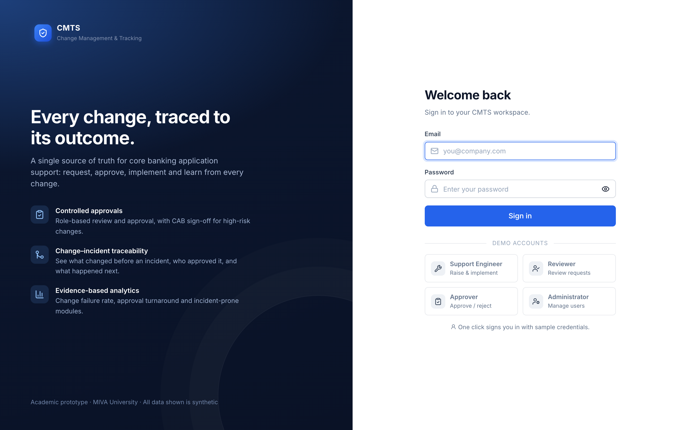

**Figure 4.2: Dashboard**

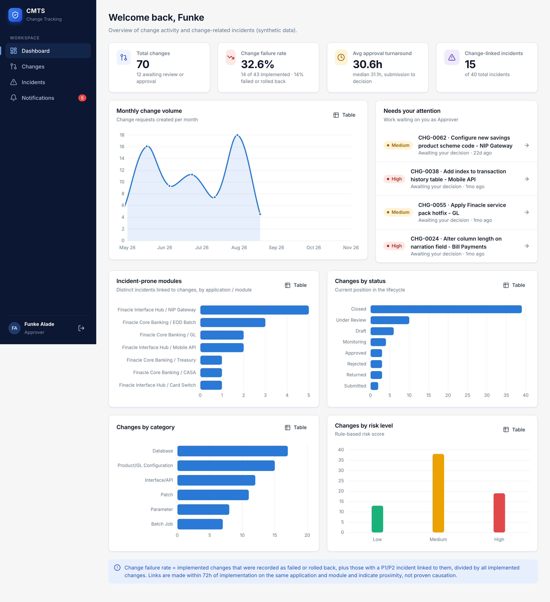

**Figure 4.3: Change repository with search and filters**

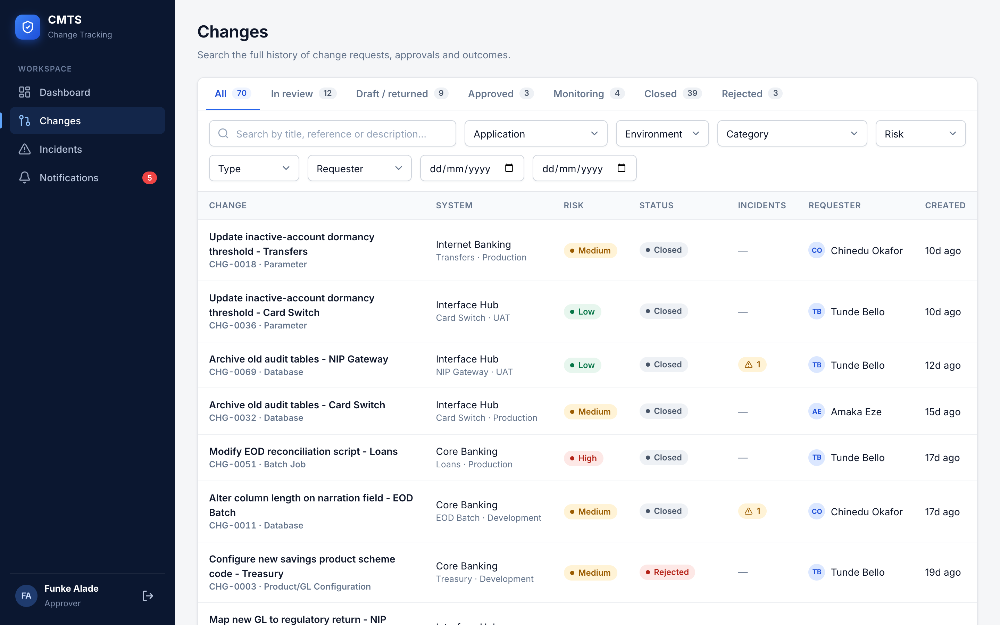

**Figure 4.4: Change request form with live risk preview**

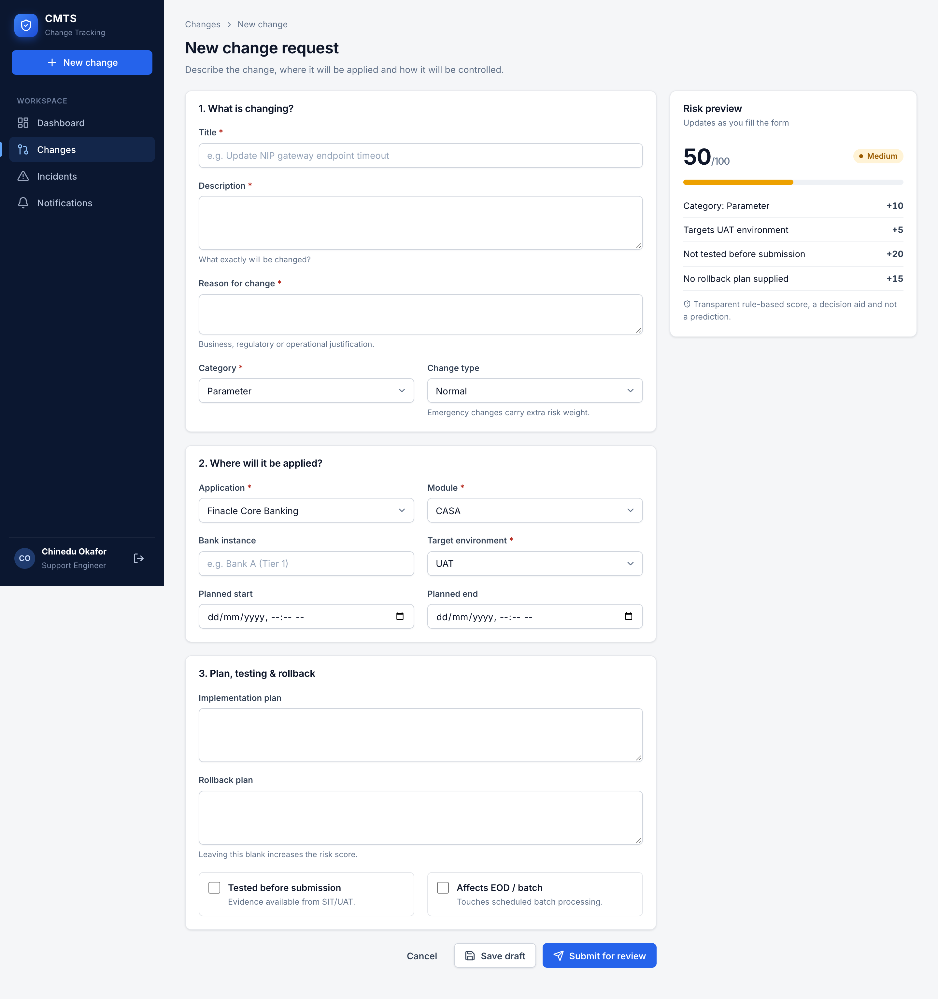

**Figure 4.5: Change awaiting approval (high-risk, CAB required)**

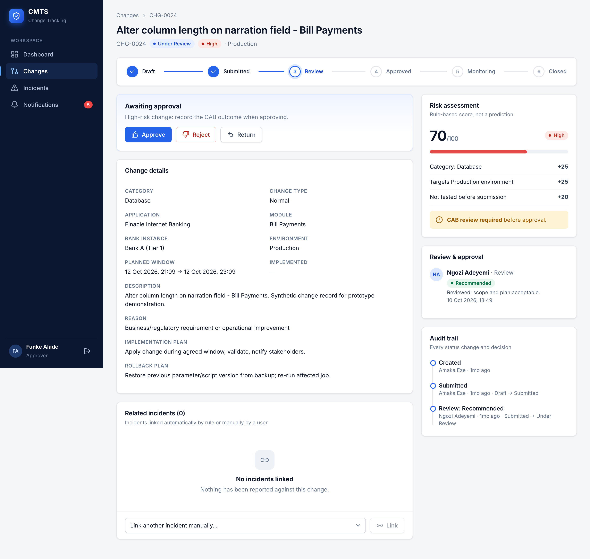

**Figure 4.6: Approval dialog requiring the CAB outcome**

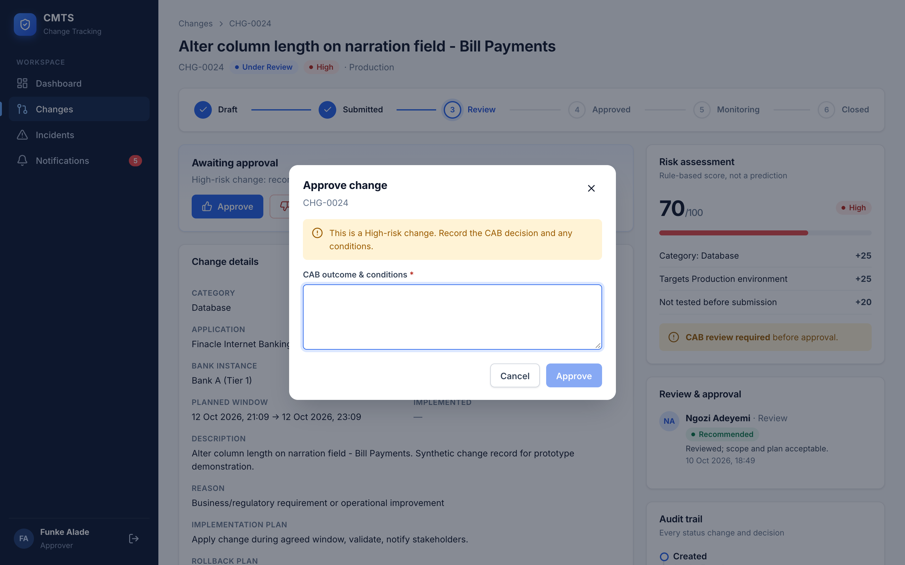

**Figure 4.7: Approved change ready for implementation**

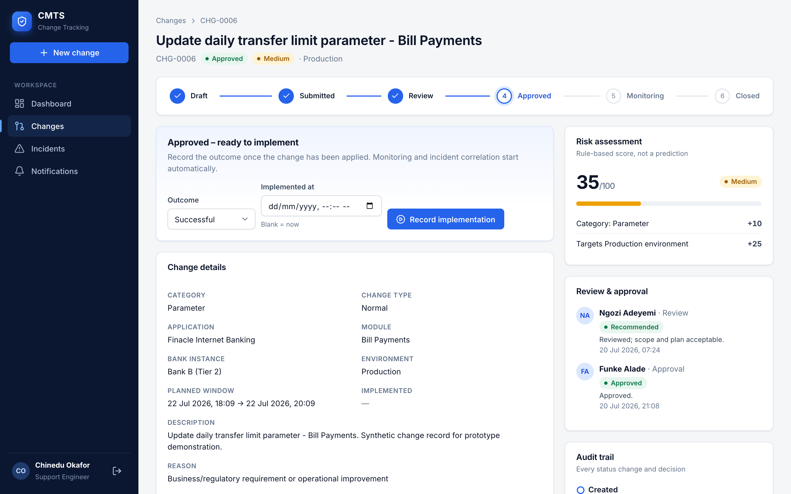

**Figure 4.8: Change in monitoring with an automatically linked incident and audit trail**

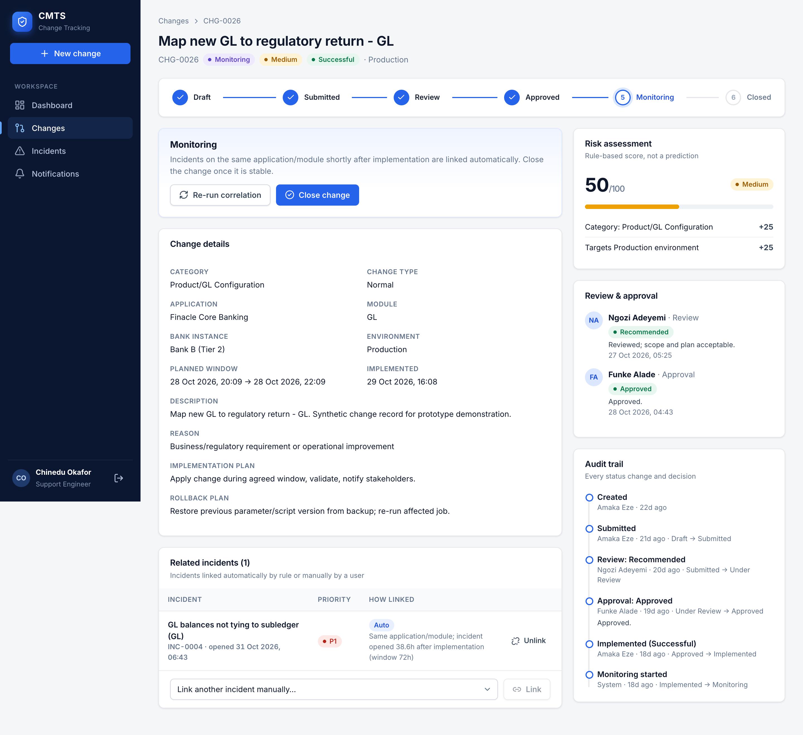

**Figure 4.9: Incident detail panel**

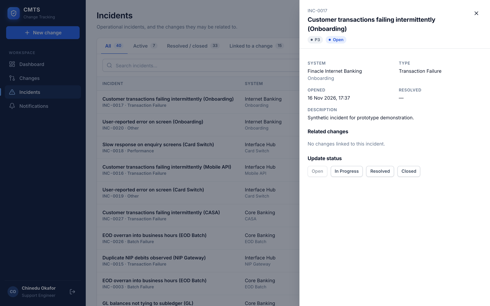

**Figure 4.10: Notifications**

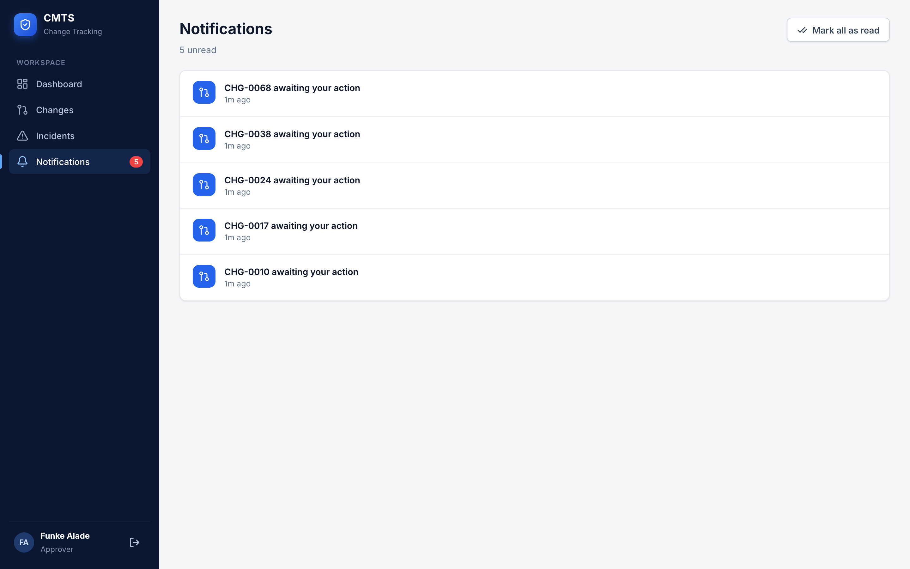

**Figure 4.11: User and role management (Administrator)**

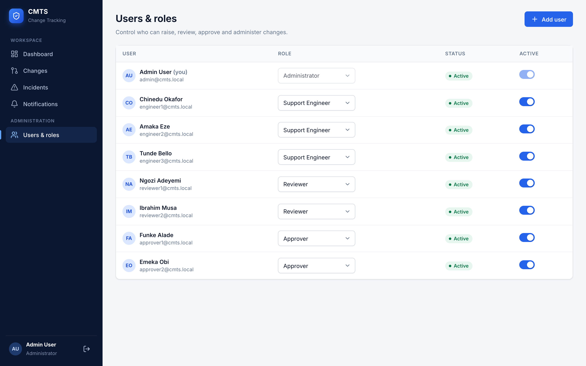

**Figure 4.12: Responsive layout at phone width**

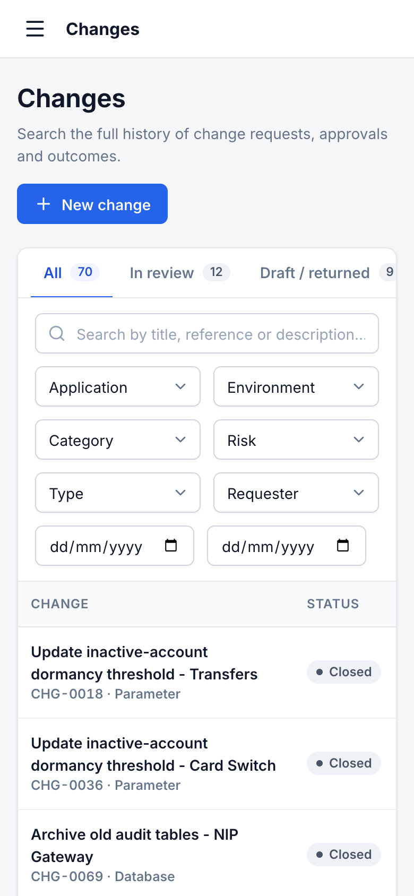

### 4.3.10 Synthetic Data

A seed script, `seed.js`, rebuilds the database schema and loads the demonstration data. It uses a fixed random seed, so the same data is produced on every run.

| Item | Quantity and description |
|---|---|
| Users | 8: one Administrator, three Support Engineers, two Reviewers and two Approvers. |
| Change requests | 70, created over roughly six months across six categories and four environments, in every lifecycle status. |
| Systems | Three applications (Finacle Core Banking, Finacle Internet Banking, Finacle Interface Hub) with eleven modules between them, such as CASA, Loans, GL, EOD Batch, NIP Gateway and Card Switch. |
| Incidents | 40: some generated after failed or high-risk changes, some unrelated background incidents, and a few recent incidents left open to demonstrate active work. |
| Approvals, history, notifications | Generated consistently with each change's status. |
| Automatic links | 16, produced by running the same correlation rules the application uses. |

The change and incident titles are modelled on activities typical of Finacle support, such as parameter updates, GL configuration, interface timeouts and EOD batch adjustments. To make patterns visible, three modules (EOD Batch, NIP Gateway and GL) were deliberately given a higher probability of failed changes and follow-on incidents. The dashboard therefore shows these modules as incident-prone because the data was designed that way. This confirms that the analytics detect the patterns present in the data. It does not show that those modules are actually riskier in any real bank.

### 4.3.11 Summary of the REST API

| Method and path | Purpose |
|---|---|
| `POST /api/auth/login`, `GET /api/auth/me` | Sign in; identify the current user. |
| `GET /api/changes` | List and filter changes (text, status, application, environment, category, risk, type, requester, date range). |
| `GET /api/changes/:id` | Change detail with approvals, history, linked incidents and the actions allowed for the current user. |
| `POST /api/changes`, `PUT /api/changes/:id` | Create a change; edit a draft or returned change. |
| `POST /api/changes/risk-preview` | Calculate the risk score for the form without saving. |
| `GET /api/changes/workflow` | Return the workflow definition. |
| `POST /api/changes/:id/submit`, `/review`, `/decide`, `/implement`, `/close` | Workflow transitions. |
| `GET /api/incidents`, `GET /api/incidents/:id` | List incidents; incident detail with linked changes. |
| `POST /api/incidents`, `PUT /api/incidents/:id/status` | Log an incident; update its status. |
| `POST /api/incidents/link`, `DELETE /api/incidents/link/:linkId` | Link or unlink an incident manually. |
| `POST /api/incidents/correlate/:changeId` | Re-run correlation for a change. |
| `GET /api/notifications`, `POST /api/notifications/read` | List notifications; mark all as read. |
| `GET /api/users`, `POST /api/users`, `PUT /api/users/:id` | List users; create a user (Administrator); change role or active state (Administrator). |
| `GET /api/analytics/summary` | Aggregated figures for the dashboard. |
| `GET /api/health` | Health check used by the hosting platform. |

## 4.4 INTEGRATION OF THE COMPONENTS

The components communicate through the REST API, following the flow designed in Chapter Three:

User → React frontend → Node.js/Express API → PostgreSQL database

When a Support Engineer submits a change, the frontend sends the request with the user's token. The API verifies the token, asks the workflow definition whether the action is allowed, and then, in a single transaction, updates the change, writes the history entry and creates the notifications for the reviewers before returning a response, which the interface confirms with a message. Approval, implementation, closure and incident linking follow the same pattern. For analytics the flow runs in the opposite direction: the database aggregates the records, the API returns the summaries, and Chart.js draws them in the browser.

## 4.5 DEPLOYMENT

### 4.5.1 Deployment Procedure

1. **Database and API (Render).** The Render Blueprint creates a PostgreSQL database and a Node.js web service. The database connection string is supplied to the API automatically. A random `JWT_SECRET` is generated by the platform. The `CORS_ORIGIN` setting is set to the address of the GitHub Pages site so that only that site may call the API from a browser.
2. **Initial data.** The synthetic data is loaded once by running the seed script from the development machine against the hosted database, using Render's external connection string with TLS enabled.
3. **Frontend (GitHub Pages).** The repository variable `VITE_API_URL` is set to the address of the Render API. The GitHub Actions workflow then installs dependencies, builds the frontend and publishes the output to GitHub Pages. The site is rebuilt whenever changes to the frontend are pushed to the `main` branch.

### 4.5.2 Checks on the Production Configuration

Before deployment, the production configuration was exercised locally with the API running in production mode on one port and the compiled frontend served from a different origin, to reproduce the Render and GitHub Pages arrangement. The following results were observed:

| Check | Result |
|---|---|
| API started in production mode without `JWT_SECRET` | The API refused to start. |
| Request from the allowed frontend origin | Cross-origin headers were returned. |
| Request from a different origin | No cross-origin headers were returned. |
| Twelve consecutive failed login attempts | The first ten returned 401; the eleventh and twelfth were blocked with 429. |
| Response headers | Security headers were present, including Content-Security-Policy, Strict-Transport-Security, X-Content-Type-Options and X-Frame-Options. |
| Full user session across the two origins (sign-in as each role, dashboard, repository, change detail, approval dialog, incident panel, user management) | Completed with no browser console or page errors. |

These checks confirm that the configuration behaves as intended in a separated-origin deployment. They are not a substitute for testing the live Render and GitHub Pages deployment, which is recorded in Chapter Five.

### 4.5.3 Hosting Considerations

The free tiers of hosting services may limit uptime, database lifetime and resources. For example, a free web service may be suspended after a period of inactivity, so the first request after a pause can be slow. These limits were accepted for a demonstration prototype and should be re-checked against the hosting provider's current terms.

## 4.6 CHALLENGES ENCOUNTERED AND HOW THEY WERE ADDRESSED

**1. Absence of real banking data.** Actual change and incident records are confidential. A seeded, reproducible synthetic dataset was designed around realistic Finacle support activities and deliberately included failure-prone modules so that the analytics could be demonstrated (Section 4.3.10). The limitation is stated wherever results are presented.

**2. Avoiding misleading correlations.** Time alone is a weak basis for linking an incident to a change. The rules require the same application and module and a bounded window, every link records why it was made, links can be removed manually, and the interface describes the links as indications for investigation (Section 4.3.6).

**3. Enforcing separation of duties.** The first version of the workflow allowed the Administrator role to perform every workflow step, and the permission checks were written separately in each route. Review showed this contradicted the intended separation of duties. The rules were consolidated into a single declarative workflow definition, the Administrator was limited to user management, and a guard was added to prevent anyone reviewing or approving their own change. Automated tests were written for each of these rules (Section 4.7).

**4. Keeping the interface consistent with the server rules.** Duplicating permission logic in the frontend risked buttons that the server would reject. The server now returns the actions allowed for the current user with each change, and the interface displays only those.

**5. Defining the change failure rate.** A rate based only on recorded failures would ignore failures that appear as later incidents, while a rate based on incidents alone would ignore rollbacks. The metric combines both, reports the components separately, and documents that hotfixes are not captured (Section 4.3.7).

**6. Consistency of related records.** A transition updates a change, its approvals, its history and its notifications. These writes are performed in one transaction with the change record locked, so a failure part-way leaves no partial record and two users cannot act on the same change simultaneously.

**7. Hosting a static frontend and an API on different services.** GitHub Pages serves only static files from a sub-path and does not support server-side routing. The frontend was configured to use hash-based routing, relative asset paths and a build-time API address, and the API was configured to accept requests only from the site's origin.

**8. Scope and time.** Priority was given to the core objectives of change recording, approval, history, incident linking and analytics. Integration with live core banking systems, automated deployment of changes, email notifications and a configurable workflow designer were excluded, in line with the project scope in Chapter One.

## 4.7 SECURITY, PERFORMANCE AND SCALABILITY

### 4.7.1 Security

| Control | Implementation |
|---|---|
| Authentication | Signed JWTs that expire after eight hours; passwords hashed with bcrypt. |
| Authorisation | Role check on every protected route; separation of duties enforced for review and approval; Administrator excluded from workflow actions. |
| Input validation | Required fields validated on the server; invalid values rejected by database CHECK constraints; user passwords of fewer than eight characters rejected; request body size limited. |
| SQL injection | All database queries use parameterised statements. |
| Brute-force protection | Login attempts limited to ten per fifteen minutes per client address. |
| Cross-origin access | In production, only the configured frontend origin is allowed. |
| Secrets | `JWT_SECRET` and database credentials are supplied through environment variables; the API will not start in production without a JWT secret. |
| Security headers | Applied by Helmet, including Content-Security-Policy and Strict-Transport-Security. |
| Audit trail | Every status change, decision and manual link is recorded with the user and time. |
| Confidential data | Only synthetic data is used. |

**Known limitations.** The prototype has not been independently security-tested, and these measures do not make it production-ready for a bank. In particular: the token is held in the browser's local storage, so a cross-site scripting flaw could expose it; tokens cannot be revoked before they expire and there is no refresh mechanism; there is no multi-factor authentication or password-reset facility; the login rate limit is held in the memory of a single server instance; any signed-in user can list the system's users; and the TLS connection to the hosted database does not verify the server certificate. These would need to be addressed before any real deployment.

### 4.7.2 Performance

Dashboard figures are computed by aggregate queries in the database and returned as small summaries. Indexes cover the fields used for filtering and correlation. The change list returns at most 500 records, which the interface paginates in the browser; for the volumes in the synthetic data this is adequate, but server-side pagination would be needed for a much larger history. No load testing was performed during implementation, so no claim is made about response times under load; measured response times, if collected, are reported in Chapter Five.

### 4.7.3 Scalability

The separation into frontend, API and database allows each to be hosted and scaled independently. Roles, categories and workflow rules are held in a small number of well-defined places, so extending them requires limited change. Future work could include server-side pagination, shared storage for rate limiting, email and messaging notifications, integration with enterprise service-management platforms, and a configurable workflow. These are possible extensions and are not features of the current prototype.

## 4.8 VERIFICATION DURING IMPLEMENTATION

An automated integration test suite was written alongside the implementation. It starts the real application and calls its API against the seeded database, so it exercises the routing, permission checks, workflow rules, database constraints and correlation logic together. All 24 tests passed on 16 November 2026. The tests are listed below; the wider test plan, user feedback and evaluation are presented in Chapter Five.

| ID | What the test verifies |
|---|---|
| AUTH-01 | A valid login returns a token and the user's role. |
| AUTH-02 | A wrong password is rejected. |
| AUTH-03 | A protected route without a token is rejected. |
| AUTH-04 | Security headers are present on responses. |
| RBAC-01 | Only a Support Engineer can create a change. |
| RBAC-02 | Only an Administrator can manage users. |
| RBAC-03 | An Administrator cannot act in the approval workflow. |
| RBAC-04 | An engineer and a reviewer cannot approve a change. |
| RBAC-05 | A requester cannot review their own change. |
| WF-01 | A change passes through the full lifecycle to Closed, with approvals and an audit trail recorded. |
| WF-02 | A high-risk change cannot be approved without a CAB comment. |
| WF-03 | Rejection and return require a comment, and a rejected change cannot be resubmitted. |
| WF-04 | A returned change can be edited and resubmitted. |
| WF-05 | Out-of-order transitions and editing after submission are refused. |
| WF-06 | Only the requester can edit or submit their draft. |
| WF-07 | The server returns only the actions the user is allowed to perform. |
| WF-08 | The workflow definition is exposed and includes the separation-of-duties rules. |
| WF-09 | Missing mandatory fields are rejected. |
| RISK-01 | Risk scoring is deterministic and explains its factors. |
| COR-01 | An incident is auto-linked only if it is on the same application and module, after implementation, and within the window. |
| COR-02 | Incidents can be linked and unlinked manually and are labelled as Manual. |
| COR-03 | An Administrator cannot log incidents. |
| AN-01 | Analytics totals are internally consistent, and the failure-rate components add up. |
| USR-01 | An Administrator can create a user; duplicate emails and weak passwords are refused. |

## 4.9 CHAPTER SUMMARY

This chapter described how the Change Management and Tracking System was implemented. A React frontend, a Node.js/Express API and a PostgreSQL database were built as three separate tiers, with JWT authentication and role-based access control. The approval workflow was implemented as a declarative set of rules that enforces role permissions, separation of duties, mandatory comments, a CAB requirement for high-risk changes and a monitoring stage before closure. Rule-based risk scoring, incident–change correlation, a defined change failure rate, notifications and a dashboard were built on a synthetic dataset designed to resemble Finacle application support. The backend and database are configured for deployment on Render and the frontend on GitHub Pages, and the production configuration was checked with the two parts running on separate origins. The challenges encountered, including the removal of administrator workflow access and the consolidation of the workflow rules, were explained, and 24 automated tests confirmed the behaviour of the main rules. The limitations of the prototype were stated, notably that it uses synthetic data, is not connected to a live banking system and has not been hardened for production use. Chapter Five presents the testing and evaluation of the prototype against the project objectives.

## REFERENCES TO ADD TO THE PROJECT REFERENCE LIST

Sources cited in this chapter that are already in your reference list: Forsgren et al. (2018).

The following are mentioned in this chapter but are not yet in your reference list and should be added if you cite them in the final report:

- GitHub. (2026). *GitHub Pages documentation*. https://docs.github.com/pages
- Render. (2026). *Render Blueprints and web service documentation*. https://render.com/docs
